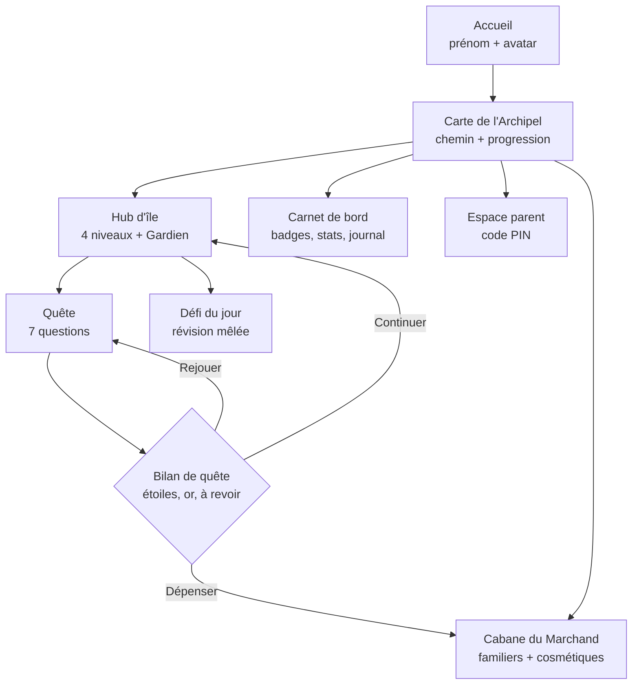
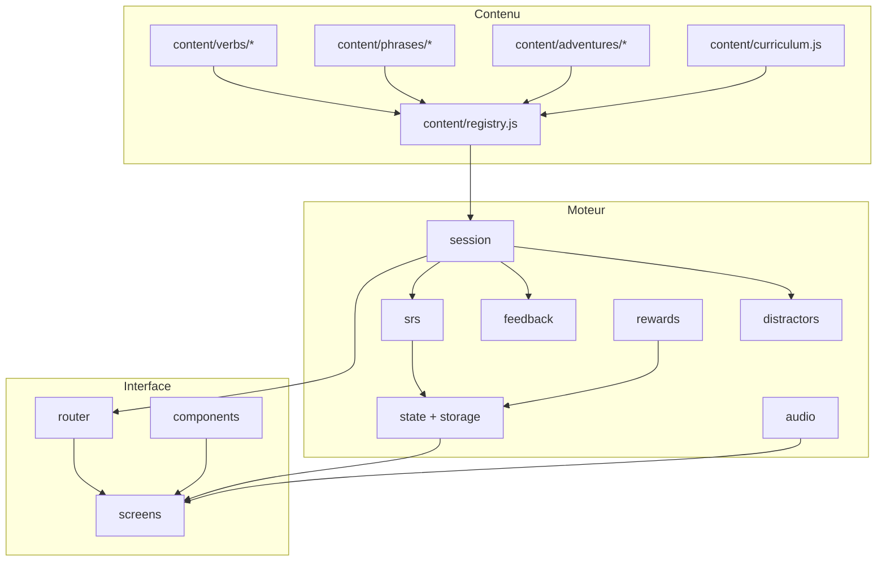

# PLAN DE RÉALISATION — « La Quête des Verbes »

**Version** : 1.0 (proposition à valider)
**Base** : `contrat.md` v1 + analyse de `verbs.js`
**Public** : enfant de 8 ans, CE2, France
**Statut** : plan seulement — aucune ligne de code applicatif écrite à ce stade

## ✅ Décisions validées (10/11/2026)

| Sujet | Décision |
|---|---|
| Direction artistique | **Album jeunesse** (illustrations à plat + pictos SVG, palette parchemin/terracotta/bleu profond) |
| Visuels | **Lot 0 restreint dès validation** : polices + UI + 6 pictos + 1 fond d'île, pour figer le style avant les ~45 assets |
| Types d'exercices | **QCM 3 choix + assemblage radical/terminaison** (tuiles déplaçables) |
| Appareil cible | **PC Windows, double-clic** → scripts classiques, namespace `window.Quete`, 100 % local, aucun CDN |
| Espace parent | **PIN 4 chiffres + appui long 2 s** sur l'engrenage, message honnête sur la sécurité |

Conséquences directes :
- Le CDN Tailwind est **abandonné** au profit d'un CSS à variables (voir § 4.9).
- Aucun `import`/`export` ES : découpage en fichiers + un seul namespace global (voir § 4.8, option A).
- Le type d'exercice « assemblage » entre dans le registre `engine/exercises.js` dès le lot L1.

---

## 0. Résumé exécutif

Le contrat pose une bonne base (thème médiéval/pirate, 4 temps, or, badges, récompenses parents, TTS). Trois choses manquent pour en faire une application réellement efficace et durable :

1. **Une colonne vertébrale pédagogique** : aujourd'hui le jeu évalue (QCM), mais n'enseigne pas explicitement, ne fait pas réviser dans le temps et ne sait pas *pourquoi* l'enfant se trompe.
2. **Un modèle de contenu séparé du moteur** : `verbs.js` mélange verbes, conjugaisons, phrases, progression et narration. Ajouter un verbe ou une aventure demande aujourd'hui de tout toucher.
3. **Une vraie direction artistique** : les emojis (⚔️ 🧙‍♀️ 🏴‍☠️) s'affichent différemment selon l'appareil et ne font pas « univers ». Il faut un kit de visuels cohérent, sous licence libre, avec traçabilité des crédits.

La proposition ci-dessous garde **100 % des intentions du contrat**, corrige 4 bugs de conception repérés dans `verbs.js`, et ajoute ce qui fait la différence à 8 ans : sessions de 3 minutes, erreur non punitive, indices gradués, révision espacée, et un univers qui raconte quelque chose.

> **Décision structurante proposée** : 4 îles = 4 temps (on garde), mais la carte devient un **chemin** (pas une grille), et chaque île se termine par un **Gardien** qui mélange les notions. C'est la progression visible qui motive, pas le menu.

---

## 1. Cadrage pédagogique

### 1.1 Profil de l'apprenant

| Caractéristique | Conséquence de design |
|---|---|
| 8 ans, CE2 | Session courte (3–5 min), 7 questions max, pas de mur de texte |
| Lecture encore en cours d'automatisation | Bouton 🔊 systématique, phrases ≤ 12 mots, vocabulaire CE2 |
| Mémoire de travail limitée | 3 choix au départ, 4 au maximum ; un seul objectif par écran |
| Besoin de contrôle | L'enfant choisit son île, son avatar, son familier ; il peut quitter et reprendre |
| Sensible à l'échec visible | Aucune perte d'or, aucun chrono, aucune série « cassée » humiliante |
| Motivé par la collection et le récit | Badges, familiers, fragments de carte, rangs |

### 1.2 Principes d'apprentissage retenus (et pourquoi)

| Principe | Traduction concrète dans l'app |
|---|---|
| **Récupération active** | L'enfant produit la forme, il ne la relit pas. QCM, assemblage de terminaison, correction de texte. |
| **Feedback immédiat et explicatif** | Message en 2 temps : *ce qui s'est passé* + *la règle en 12 mots*. Jamais seulement « Faux ». |
| **Erreur = information** | 2 essais, puis on montre la réponse et on fait **retaper** la bonne forme (correction active). |
| **Répétition espacée** | Chaque carte (verbe × temps × personne) a une boîte de Leitner : revue à J+1, J+3, J+7, J+21. |
| **Entraînement mêlé (interleaving)** | Dès qu'un 2e temps est connu : 1 question « mélange » par quête, avec indice temporel (*hier / maintenant / demain*). |
| **Charge cognitive maîtrisée** | Radical et terminaison mis en évidence par la couleur ; on n'apprend pas 6 personnes d'un coup. |
| **Sentiment de compétence** | Difficulté adaptative : 2 erreurs de suite → 2 choix + indice automatique. |
| **Autonomie / lien** | Rangs, carnet de bord, et « parchemin de réussite » à montrer aux parents. |

### 1.3 Ce que l'application ne fera **pas** (choix assumés)

- ❌ Pas de chronomètre, pas de classement, pas de comparaison sociale.
- ❌ Pas de pénalité financière, pas de « vie perdue », pas de jeu bloqué.
- ❌ Pas de publicité, pas de compte en ligne, pas de données envoyées.
- ❌ Pas de QCM à 6 options « pour faire sérieux ».
- ❌ Pas de texte long à lire avant de jouer.

### 1.4 Progression CE2 proposée

| Monde | Temps | Objectif CE2 | Pièges travaillés en priorité |
|---|---|---|---|
| L'Île du Présent | Présent | 1er groupe + être/avoir + verbes fréquents | *tu* → -s ; *il* → -e/-t ; *nous* -ons / *vous* -ez / *ils* -ent ; *je* + voyelle |
| La Vallée des Souvenirs | Imparfait | Radical + -ais/-ais/-ait/-ions/-iez/-aient | confusion -ais/-ait/-aient ; *nous* -ions (pas -ons) |
| L'Océan des Prophéties | Futur simple | Infinitif + -ai/-as/-a/-ons/-ez/-ont | *je* -ai vs *il* -a ; radicaux irréguliers (ser-, aur-, ir-, fer-) |
| La Crique des Exploits | Passé composé | Auxiliaire + participe (-é) | avoir/être ; -é vs -er ; accord (extension) |
| ⚓ Le Port des Phrases *(bonus, déblocable)* | Tous | Remettre une phrase en ordre, choisir le temps selon l'indice | Transfert, production |

> À caler sur la progression réelle de la classe : un fichier `curriculum.js` permettra de réordonner les niveaux sans toucher au moteur.

### 1.5 Modèle de maîtrise (anti-frustration)

- **1 ★** : quête terminée (même avec des erreurs).
- **2 ★** : ≥ 80 % de bonnes réponses **du premier coup**.
- **3 ★** : 100 % du premier coup, sans indice.
- Les étoiles ne se **perdent jamais**. On peut rejouer pour améliorer.
- Un niveau est « consolidé » quand les 3 ★ sont obtenues **et** que la révision espacée ne signale plus d'échec.

### 1.6 Mécanique de l'erreur (le cœur pédagogique)

Séquence exacte d'une question :

```
1. Écoute / lecture (TTS disponible)
2. Réponse (3 choix)
3. Feedback immédiat
   ├─ Correct → encouragement court + micro-explication (1 phrase) + or
   └─ Incorrect → "Presque !" + indice ciblé + 2e essai
4. Si 2e échec → réponse révélée + micro-leçon + l'enfant retape la bonne forme
5. La carte repart en fin de quête (réancrage) puis en révision espacée
```

**Typologie d'erreurs** (stockée pour le tableau de bord parent) :

| Code | Exemple | Micro-leçon associée |
|---|---|---|
| `terminaison` | *tu joue* | « Avec *tu*, le verbe prend presque toujours un **-s**. » |
| `radical` | *nous mangons* | « Pour garder le son [ʒ], on écrit **mangeons**. » |
| `auxiliaire` | *j'ai allé* | « *Aller* se conjugue avec **être** : je suis allé. » |
| `participe` | *j'ai manger* | « Après *avoir*, on écrit **-é** : mangé. » |
| `accord` | *elle est parti* | « Avec *être*, le participe s'accorde : **partie**. » |
| `temps` | futur au lieu d'imparfait | « *Hier*, c'est le passé : on utilise l'**imparfait**. » |
| `homophone` | *il et* / *il est* | « *Est*, c'est le verbe être. *Et*, c'est pour ajouter. » |

### 1.7 Rituel proposé (à afficher dans l'espace parent)

> **Le contrat du moussaillon** : 1 quête = 3 minutes. On peut faire 2 quêtes par jour. On arrête quand la boussole dit « escale ». L'enfant montre son carnet de bord le vendredi.

Ce rituel règle 80 % des conflits d'écran et donne un cadre positif.

---

## 2. Récit, boucle de jeu et économie

### 2.1 Fil rouge

L'Amiral **Tempus** a brisé la **Boussole des Temps** : ses 4 aiguilles sont éparpillées dans l'Archipel. L'enfant est *cartographe apprenti* ; chaque île reconquise rapporte une aiguille et un fragment de carte. Quand les 4 aiguilles sont réunies : traversée finale vers le Trésor de l'Archipel.

Pourquoi ça marche : objectif clair, progression visible, récompense narrative (pas seulement des pièces), et fin atteignable (un enfant de 8 ans doit pouvoir **terminer** le jeu).

### 2.2 Rangs (progression identitaire)

Moussaillon → Matelot → Quartier-maître → Pilote → Capitaine → Amiral des Verbes

### 2.3 Boucle courte / moyenne / longue

| Boucle | Durée | Contenu | Récompense |
|---|---|---|---|
| Courte | 20–40 s | 1 question | +2 or, micro-encouragement |
| Moyenne | 3–4 min | 1 quête de 7 questions | étoiles + bonus + carte mise à jour |
| Longue | 1 semaine | 1 île + son Gardien | aiguille, badge, familier |

### 2.4 Économie (simple, sans inflation, sans blocage)

| Gain | Montant |
|---|---|
| Bonne réponse du premier coup | +2 or (+3 aux niveaux 3–4) |
| Bonne réponse après correction | +1 or (on récompense l'obstination) |
| Quête sans aucune erreur | +10 or |
| Gardien vaincu | +25 or |

| Dépense | Prix |
|---|---|
| Perroquet (relit la phrase) | 60 or |
| Dragonneau (élimine 1 mauvais choix, 1×/quête) | 120 or |
| Cheval (donne la règle, 1×/quête) | 200 or |
| Chapeau / déguisement cosmétique | 40–80 or |
| Récompense réelle (définie par les parents) | 150 / 300 / 500 or |

**Garde-fous** :
- Les familiers **aident**, ils ne jouent pas à la place de l'enfant (usages limités par quête).
- Un puits à or (cosmétiques) évite l'accumulation infinie.
- Aucun achat ne conditionne l'accès à un contenu pédagogique.

### 2.5 Anti-« streak » toxique

La série de bonnes réponses existe, mais elle est présentée comme un **record personnel** (« ton meilleur enchaînement : 7 »), jamais comme une flamme qui s'éteint. En cas d'erreur : simple retour à 0, sans message négatif.

---

## 3. Écrans, parcours et UX

### 3.1 Parcours des écrans



### 3.2 Détail des écrans

#### ① Accueil
- Champ prénom (une seule fois, modifiable), 3 avatars + 3 autres en option.
- Détection de profil existant → bouton **« Reprendre l'aventure »** bien plus gros que « Nouveau ».
- Réglages accessibles : 🔊 son, taille du texte, réduire les animations.

#### ② Carte de l'Archipel (remplace la « grille de 4 cartes »)
- Chemin sinueux, 4 îles + 1 port bonus.
- Chaque île : nom, temps, étoiles obtenues (x/12), cadenas si prérequis non rempli.
- HUD : avatar, prénom, or, rang, aiguilles récoltées (0–4).
- Les badges sont dans le carnet, pas sur la carte (évite la surcharge).

#### ③ Hub d'île
- 4 niveaux en liste verticale : titre, groupe de verbes, étoiles, bouton « Jouer ».
- **Gardien** en bas, verrouillé tant que les 4 niveaux ne sont pas à 1 ★.
- Bandeau « À revoir » : 0–3 cartes dues aujourd'hui (révision espacée).

#### ④ Quête (écran de jeu)
De haut en bas :
1. Barre de progression segmentée (7 segments, pas un pourcentage abstrait) + bouton ✕ (quitter, progression conservée).
2. Aiguille/boussole décorative discrète.
3. **Phrase à trou**, 24 px minimum, pronom coloré, verbe à l'infinitif en petit entre parenthèses, bouton 🔊.
4. Zone de réponse : 3 gros boutons (min. 56 px de haut), puis 2 après adaptation.
5. Zone de feedback (hauteur réservée pour éviter le saut de mise en page).
6. Barre d'aides : 💡 indice (1–3), 🐉 éliminer un choix, 🦜 relire.

#### ⑤ Bilan de quête
- 0–3 étoiles animées, or gagné, 1 phrase de progrès (« Tu as réussi *nous* à l'imparfait ! »).
- « Les 2 choses à revoir » avec les formes correctes.
- Boutons : Rejouer / Carte / Boutique.

#### ⑥ Cabane du Marchand
- Familiers (avec description de **ce qu'ils font**), cosmétiques, récompenses parents.
- Chaque achat affiche le solde restant avant validation (pas d'achat accidentel).

#### ⑦ Carnet de bord
- Badges (grisés = objectif visible, jamais caché).
- Statistiques douces : temps joué, verbes rencontrés, temps le plus solide.
- « Mon journal » : 1 ligne par quête terminée.

#### ⑧ Espace parent
- Code PIN 4 chiffres + appui long (voir § 7.3).
- Courbe de progression, top 5 des erreurs, temps de jeu par jour.
- Configuration des 3 récompenses réelles + prix + validation.
- Export / import de la sauvegarde (JSON), réinitialisation.
- Tout est local : mention explicite « aucune donnée ne quitte cet appareil ».

#### ⑨ Réglages / pause
- Son, voix (choix parmi les voix `fr-FR` disponibles), vitesse de lecture, taille de texte, animations réduites, contraste renforcé, réinitialiser.

### 3.3 Couleurs des pronoms

Le contrat demande des couleurs fixes. Proposition compatible accessibilité (jamais la couleur seule) :

| Personne | Couleur | Repère redondant |
|---|---|---|
| je / tu | bleu marine `#1E3A8A` | soulignement plein |
| il / elle / on | bleu ardoise `#2563EB` | soulignement pointillé |
| nous / vous | vert émeraude `#047857` | double soulignement |
| ils / elles | violet profond `#6D28D9` | soulignement ondulé |

Chaque pronom est **aussi** identifiable par sa forme écrite et par le repère, donc lisible en cas de daltonisme. Contraste vérifié ≥ 4,5:1 sur fond parchemin.

### 3.4 Audio

- `speechSynthesis`, langue `fr-FR`, débit 0,9, **lecture de la phrase seule** (jamais la réponse).
- Auto-lecture optionnelle (utile pour un lecteur fragile).
- Sons d'interface très courts, volume modéré, coupables séparément de la voix.
- Fallback silencieux si aucune voix française n'est installée.

---

## 4. Architecture technique évolutive

### 4.1 Principes

1. **Contenu ≠ moteur ≠ présentation.** Ajouter un verbe ne doit jamais toucher au moteur.
2. **Zéro dépendance réseau à l'exécution.** L'application doit fonctionner hors ligne, y compris en double-clic sur `index.html`.
3. **Un registre + un validateur** : tout contenu déclaré est vérifié automatiquement (formes manquantes, doublons, ambiguïtés).
4. **Des packs** : `verbs/`, `adventures/`, `phrases/` sont des dossiers ; ajouter un fichier suffit.

### 4.2 Arborescence proposée

```
aventure-conjugaison/
├─ index.html
├─ contrat.md
├─ PLAN.md
├─ assets/
│  ├─ css/
│  │  ├─ tokens.css          variables : couleurs, tailles, espacements
│  │  ├─ base.css            reset, typographie, accessibilité
│  │  └─ components.css      boutons, cartes, cadres, badges
│  ├─ fonts/                 polices OFL auto-hébergées (woff2)
│  ├─ img/
│  │  ├─ ui/                 boutons 9-slice, cadres, pictos SVG
│  │  ├─ worlds/             4 fonds d'île + carte
│  │  ├─ avatars/            6 avatars
│  │  ├─ pets/               6 familiers
│  │  └─ badges/             8 badges
│  ├─ sfx/                   sons d'interface
│  └─ manifest.json          id, fichier, licence, auteur, source
├─ content/
│  ├─ registry.js            enregistrement + validation
│  ├─ curriculum.js          ordre des mondes/niveaux, prérequis
│  ├─ verbs/
│  │  ├─ etre.js
│  │  ├─ avoir.js
│  │  ├─ jouer.js
│  │  └─ ...
│  ├─ phrases/
│  │  ├─ present.js          banque de phrases par temps
│  │  └─ ...
│  └─ adventures/
│     ├─ ile-present.js      récit, décors, dialogues, Gardien
│     └─ ...
├─ engine/
│  ├─ state.js               état, sauvegarde, migration
│  ├─ storage.js             localStorage versionné + export/import
│  ├─ session.js             génération de quête (7 questions)
│  ├─ distractors.js         fabrique de mauvais choix
│  ├─ exercises.js           registre des types d'exercices
│  ├─ feedback.js            micro-leçons par type d'erreur
│  ├─ srs.js                 répétition espacée (Leitner)
│  ├─ rewards.js             or, badges, familiers
│  └─ audio.js               TTS + SFX
├─ ui/
│  ├─ router.js              showScreen + transitions
│  ├─ screens/*.js           un fichier par écran
│  └─ components/*.js        bouton, carte, barre, modale
├─ tools/
│  └─ lint-content.js        validation du contenu (node, sans dépendance)
└─ CREDITS.md                licences et attributions des visuels
```

### 4.3 Dépendances entre modules



### 4.4 Modèle de données v2

**Verbe** (une seule source de vérité, indépendante du temps joué) :

```js
{
  id: "etre",
  infinitif: "être",
  groupe: 3,
  auxiliaire: "avoir",
  participe: "été",
  frequence: 5,                  // priorité pédagogique
  formes: {
    present:   { je: "suis", tu: "es", il: "est", elle: "est",
                 nous: "sommes", vous: "êtes", ils: "sont", elles: "sont" },
    imparfait: { ... },
    futur:     { ... },
    passe_compose: { je: "ai été", ... }
  },
  pieges: ["tu es / il est", "vous êtes"],
  notes: { present: "Avec « tu », être devient « es »." }
}
```

**Phrase** (le pronom est **dans** le texte : plus d'ambiguïté) :

```js
{
  id: "etre-present-tu-01",
  verbe: "etre",
  temps: "present",
  personne: "tu",                // métadonnée : couleur, distracteurs, stats
  texte: "Tu {trou} le capitaine de ce navire !",
  reponse: "es",
  difficulte: 1,
  univers: "pirates",
  explication: "Avec « tu », être devient « es ».",
  tags: ["auxiliaire", "2e personne"]
}
```

**Aventure** (récit + habillage, sans logique) :

```js
{
  id: "ile-present",
  temps: "present",
  nom: "L'Île du Présent",
  fond: "worlds/ile-present.webp",
  intro: "Les palmiers murmurent au présent…",
  niveaux: [
    { id: "present-1", titre: "Les Ancres de l'Esprit",
      groupe: "Auxiliaires", verbes: ["etre", "avoir"], difficulte: 1 }
  ],
  gardien: { nom: "Le Crabe Chronomètre", questions: 7, mixte: true },
  recompense: { aiguille: "present", badge: "moussaillon-present" }
}
```

### 4.5 Ajouter du contenu : 3 gestes

| Objectif | Action | Ce qu'il faut toucher |
|---|---|---|
| Ajouter un verbe | Créer `content/verbs/chanter.js` avec ses 4 temps | 1 fichier |
| Ajouter des phrases | Ajouter des entrées dans `content/phrases/present.js` | 1 fichier |
| Ajouter une aventure | Créer `content/adventures/port-des-phrases.js` + l'enregistrer | 1 fichier + 1 ligne |
| Ajouter un type d'exercice | Créer `engine/exercises/assemble.js` + l'enregistrer | 1 fichier + 1 ligne |
| Changer l'ordre pédagogique | Éditer `content/curriculum.js` | 1 fichier |

Le registre expose `registerVerb`, `registerPhrases`, `registerAdventure`, `registerExercise` et vérifie au chargement :
- toutes les formes demandées existent ;
- aucune phrase ne contient deux réponses possibles ;
- le pronom est bien présent dans le texte ;
- les identifiants sont uniques ;
- les fichiers d'images référencés existent.

### 4.6 Générateur de distracteurs (règles)

Priorité des leurres, du plus pédagogique au moins utile :

1. **Autre personne du même verbe** (le piège n°1) : *es / est / suis*.
2. **Confusion de terminaison** : -ais / -ait / -aient ; -ons / -ez / -ent ; -ai / -as / -a.
3. **Mauvais auxiliaire** (passé composé) : *j'ai allé*.
4. **Mauvais participe** : *mangé / manger*.
5. **Radical erroné** : *mangons*.
6. Un seul leurre « hors sujet » maximum, et seulement en niveau 4.

Contraintes techniques :
- dédoublonnage après normalisation (accents, casse) : indispensable car *je* et *tu* de l'imparfait sont identiques (*chantais*) ;
- vérification qu'**une seule** option est correcte ;
- jamais deux leurres du même type à la suite ;
- 2 choix si l'enfant vient d'échouer deux fois, 4 choix au niveau expert.

### 4.7 Persistance, versions, sauvegarde

- Clé unique `quete-verbes:v1`, objet `{ version, profil, progression, srs, economie, reglages }`.
- **Migration** : si `version` < actuelle, fonction de migration (jamais de perte de profil).
- Sauvegarde automatique après chaque question (l'enfant peut fermer l'onglet).
- **Export/import JSON** dans l'espace parent (changement d'appareil, sauvegarde).
- Limite de taille surveillée : la SRS ne stocke qu'un entier par carte.

### 4.8 Contrainte `file://` (important)

Si l'application doit s'ouvrir par double-clic, les **modules ES ne fonctionnent pas** (CORS). Deux options :

| Option | Avantage | Inconvénient |
|---|---|---|
| **A. Scripts classiques + namespace global** (`window.Quete`) | Fonctionne partout, zéro installation | Moins « moderne », ordre des `<script>` à respecter |
| B. Modules ES + petit serveur local (`npx serve`) | Code plus propre | Nécessite une commande, bloque le double-clic |

**Recommandation** : A, avec des fichiers découpés et un namespace unique. On garde la modularité par fichiers, pas par `import`. Si l'application est un jour hébergée (GitHub Pages), on pourra passer à B sans réécrire le contenu.

### 4.9 Hors ligne et performance

- Aucun appel réseau à l'exécution : polices, images, sons, CSS en local.
- Abandon du CDN Tailwind au profit d'un CSS à variables (≈ 500 lignes) → pas de flash, pas de dépendance, contrôle total des tailles enfant.
- Budget : < 3 Mo au total, < 1 s de premier affichage sur un PC modeste.
- Option PWA (manifest + service worker) en lot final, si hébergement.

---

## 5. Direction artistique et visuels libres de droits

### 5.1 Trois pistes, une recommandation

| Piste | Description | Ressenti 8 ans | Coût de production |
|---|---|---|---|
| **A. Album jeunesse** ✅ | Illustrations à plat, contours doux, parchemin, terracotta, bleu profond ; pictos épurés | Chaleureux, lisible, « vrai jeu » | Moyen (kit existant + retouches) |
| B. Pixel art rétro | Kenney 1-Bit / pixel packs, CC0 | Nostalgique pour les parents, moins « album » | Faible |
| C. Papier découpé / collage | Textures, calques, ombres | Original, très lisible | Élevé (sur-mesure) |

**Recommandation : A**, avec des pictos vectoriels (SVG) pour l'interface et des illustrations WebP pour les fonds. Une seule règle d'or : **ne jamais mélanger photo, 3D et emoji** dans le même écran.

### 5.2 Inventaire des visuels nécessaires

| Catégorie | Quantité | Format | Usage |
|---|---|---|---|
| Texture parchemin (tuilable) | 1 | WebP 512² | Fond global |
| Cadres bois / pierre (9-slice) | 3 | PNG ou SVG | Cartes, modales |
| Fonds d'île panoramiques | 4 | WebP 1600×900 | Hub, carte |
| Carte de l'archipel | 1 | SVG ou WebP | Écran carte |
| Pictos UI | ~14 | SVG | or, étoile, badge, son, indice, retour, croix, check, coffre, boussole, sablier, carte, familier, cadenas |
| Avatars | 6 | WebP 256² | Accueil, HUD |
| Familiers | 6 | WebP 256² | Boutique, aides |
| Badges | 8 | SVG | Carnet de bord |
| Gardiens / boss | 4 | WebP 512² | Fin d'île |
| Aiguilles de boussole | 4 | SVG | Récompense narrative |
| Sons d'interface | 6 | OGG/MP3 court | Clic, correct, erreur douce, pièce, fanfare, page |
| Polices | 2 | WOFF2 | Titres + corps |

Total ≈ **45 fichiers**, budget < 3 Mo.

### 5.3 Sources libres de droits (à télécharger en étape 2)

| Source | Contenu visé | Licence | Attribution | Remarque |
|---|---|---|---|---|
| **Kenney.nl** (`kenney.nl/assets`) | Packs UI, cadres médiévaux, icônes, sons | **CC0** | Non requise (mais créditons) | Le meilleur rapport cohérence/coût ; packs « UI Pack », « Fantasy UI Borders », « RPG Audio » |
| **game-icons.net** | 4 000+ pictos SVG (épée, pirate, coffre, château, boussole) | **CC BY 3.0** | **Obligatoire** | Idéal pour les pictos UI, recolorables en CSS |
| **OpenGameArt.org** | Illustrations médiévales/pirates | Variable (CC0, CC BY, CC BY-SA) | Selon l'asset | Vérifier **chaque** fichier ; filtrer CC0 |
| **Wikimedia Commons** | Cartes marines anciennes, gravures domaine public | Domaine public | Non | Parfait pour la texture « carte au trésor », esprit authentique |
| **Openclipart.org** | Vecteurs simples | **CC0** | Non | Dépannage ponctuel |
| **Pixabay** | Textures papier, ciels, mer | Licence Pixabay | Non | Ne pas prendre d'images « IA » ou de personnes identifiables |
| **Google Fonts** | `Baloo 2` (titres), `Nunito` (corps) ou `Atkinson Hyperlegible` (option dys) | **OFL** | Non | Auto-héberger en WOFF2 |
| **Twemoji / Noto Emoji** | Remplacer les emojis système par des SVG cohérents | CC BY 4.0 / Apache 2.0 | Oui pour Twemoji | Corrige le rendu différent Windows/Android/iPad |

> **Point important** : le contrat repose sur des emojis. Sur un PC Windows, ⚔️ 🧙‍♀️ 🏴‍☠️ ne ressemblent pas du tout à ce que voit un iPad. Remplacer les emojis **structurants** (avatars, familiers, badges) par des SVG du pack choisi est un gain visuel et un gain de lisibilité.

### 5.4 Règles d'assets

- Nommage : `categorie/sujet-variante-taille.webp` → `worlds/ile-present-1600.webp`.
- SVG pour tout ce qui est icône (net à toute taille, recolorable).
- WebP pour les illustrations ; PNG uniquement pour les 9-slice avec transparence.
- Chaque asset est déclaré dans `assets/manifest.json` :
  ```json
  { "id": "ile-present", "file": "worlds/ile-present-1600.webp",
    "licence": "CC0", "auteur": "Kenney", "source": "https://kenney.nl/..." }
  ```
- `CREDITS.md` généré depuis ce manifest → conformité et transparence.
- Fallback CSS (dégradé + motif) si une image manque : le jeu reste jouable.

### 5.5 Charte rapide

| Rôle | Valeur | Usage |
|---|---|---|
| Parchemin | `#FDF6E3` / `#F5E6C8` | Fonds |
| Bois | `#7C4A21` / `#4E2E14` | Bordures, boutons secondaires |
| Or | `#D4A017` / `#F2C14E` | Récompenses |
| Mer | `#0E7490` | Monde futur |
| Encre | `#2B2118` | Texte principal |
| Succès | `#15803D` | Feedback positif |
| Erreur douce | `#B45309` (ambre, pas rouge vif) | Feedback d'erreur |

Typographie : titres `Baloo 2` 700 ; corps `Nunito` 400/700, 18 px minimum, 24 px pour la phrase à trou, interligne 1,5.

---

## 6. Plan de réalisation (étape 2)

| Lot | Contenu | Livrable vérifiable | Estimation |
|---|---|---|---|
| **L0 — Socle** | `index.html`, tokens CSS, routeur d'écrans, état, sauvegarde versionnée | On navigue entre 4 écrans vides, le profil survit au rechargement | 2 h |
| **L1 — Moteur de question** | Sélecteur, distracteurs, feedback, TTS, 2e essai, correction active | 7 questions jouables depuis un JSON de test | 3 h |
| **L2 — Contenu v2** | Verbes canoniques, phrases corrigées, lint | `npm run lint` (ou `node tools/lint-content.js`) = 0 erreur | 4 h |
| **L3 — Progression & gamification** | Carte, îles, étoiles, or, badges, familiers, SRS | Une île terminable de bout en bout | 3 h |
| **L4 — Parents** | PIN, récompenses, statistiques, export/import | Parchemin imprimable + sauvegarde exportée | 2 h |
| **L5 — Visuels** | Téléchargement, tri, optimisation, intégration, crédits | 45 assets intégrés, `CREDITS.md` complet | 3 h |
| **L6 — Polish** | Responsive, animations, accessibilité, réglages | Recette accessibilité passée | 2 h |
| **L7 — Recette** | Tests manuels + test « vrai enfant » | Liste de bugs corrigée | 2 h |

**Total ≈ 21 h**, livrable jouable dès L3, complet en L7.

---

## 7. Qualité, tests, sécurité

### 7.1 Tests du contenu (automatisables, sans dépendance)

- Toute forme référencée existe dans le verbe.
- Aucune phrase sans pronom visible.
- Aucune réponse vide, aucun doublon d'id.
- Un seul choix correct possible par question (test exhaustif sur 500 tirages).
- Toutes les images référencées existent.

### 7.2 Recette fonctionnelle (extrait)

- [ ] Recharger la page en pleine quête → la question en cours revient.
- [ ] Couper le son → aucune voix, les SFX restent si activés.
- [ ] Répondre faux deux fois → réponse révélée, puis re-taper la bonne forme.
- [ ] Écran 320 px de large → aucun débordement, boutons ≥ 56 px.
- [ ] Navigation 100 % clavier (Tab, Entrée, 1-2-3).
- [ ] Aucune requête réseau après chargement (onglet Réseau vide).
- [ ] `localStorage` vidé → retour à l'accueil sans erreur.

### 7.3 Espace parent : le mini-calcul est insuffisant

Un enfant de CE2 sait calculer 7 × 8. Proposition :

- **Code PIN 4 chiffres** défini au premier accès,
- accès par **appui long 2 s** sur un petit engrenage (invisible pour une exploration rapide),
- message honnête : « Cet espace n'est pas un coffre-fort, il évite juste les clics par erreur. »

### 7.4 Sécurité et vie privée

Aucune donnée personnelle réelle nécessaire (prénom seul), aucun serveur, aucune analytique, aucun lien sortant. L'export JSON reste sur l'appareil.

---

## 8. Risques et parades

| Risque | Impact | Parade |
|---|---|---|
| Lassitude après 2 semaines | Abandon | Variété d'exercices, défi du jour, récit qui avance, sessions courtes |
| Surcharge visuelle | fatigue, erreurs | 1 objectif par écran, animations désactivables |
| Contenu ambigu (bug actuel) | apprentissage faux | Lint + réécriture des phrases (§ 9) |
| Voix TTS robotique | gêne | Choix de voix + réglage débit + bouton non automatique |
| Perte de sauvegarde | démotivation | Sauvegarde à chaque question + export JSON |
| Licences mal tracées | problème légal | `manifest.json` + `CREDITS.md` dès le premier asset |
| Inflation de l'or | récompenses triviales | Puits à or cosmétique + prix fixes |
| Dépendance CDN | jeu cassé hors ligne | Tout en local |

---

## 9. Corrections à apporter au contenu actuel (`verbs.js`)

Ces points sont **bloquants pédagogiquement** et seront traités au lot L2 :

1. **Pronom absent → question insoluble.**
   `{ pronom: "je", texte: "___ un fier chevalier du roi." }`
   L'enfant voit « ___ un fier chevalier » sans savoir qui parle → 8 réponses possibles.
   *Correction* : `"Je {trou} un fier chevalier du roi."`

2. **Pronom dupliqué.**
   `{ pronom: "je", texte: "J'___ autrefois un simple paysan." }` + affichage du pronom → « Je J'___ ».
   *Correction* : le pronom reste dans le texte, le champ `personne` ne sert qu'à la logique.

3. **Sujet lexical annoncé comme pronom.**
   `{ pronom: "il", texte: "Le jeune dragon ___ à toute vitesse." }`
   L'indice « avec *il* » est faux ici : le sujet est un groupe nominal.
   *Correction* : soit écrire « Il ___ à toute vitesse », soit adapter l'indice au GN.

4. **Formes identiques entre personnes.**
   À l'imparfait, *je chantais* = *tu chantais*. Sans dédoublonnage, un distracteur peut être égal à la réponse.
   *Correction* : normalisation + dédoublonnage dans `distractors.js`.

5. **Couverture incomplète.** Plusieurs verbes n'ont pas de phrases pour *elle(s)*, *vous*, *ils*. Le lint signalera les trous et proposera un taux de couverture minimal (ex. 5 personnes sur 6 par niveau).

6. **`voler` est ambigu** (voler dans les airs / dérober) : à garder avec un contexte très explicite ou à remplacer.

7. **Passé composé avec *être* absent** : aucun accord de participe n'est travaillé. À ajouter en extension (ou en niveau bonus), car c'est le piège majeur du CE2/CM1.

8. **Verbes manquants pour le CE2** : *venir, prendre, voir, pouvoir, vouloir, chanter, parler, regarder, écrire, lire*… Objectif proposé : 20 verbes × 4 temps, avec phrases pour 5–6 personnes.

---

## 10. Décisions ouvertes et arbitrages

| # | Question | Décision / recommandation par défaut |
|---|---|---|
| 1 | Style visuel | ✅ **Album jeunesse** + pictos SVG |
| 2 | Quand télécharger les visuels | ✅ **Lot 0 restreint** dès validation |
| 3 | Types de réponses | ✅ **QCM 3 choix + assemblage radical/terminaison** (saisie clavier en option, non prévue en v1) |
| 4 | Appareil cible | ✅ **PC Windows (double-clic)** → scripts classiques, 100 % local |
| 5 | Accès parent | ✅ **PIN 4 chiffres + appui long** |
| 6 | Périmètre des temps | **4 temps actuels enrichis**, passé composé avec *être* en niveau bonus |
| 7 | Avatar | 3 avatars du contrat + 3 autres pour la diversité |
| 8 | Récompenses réelles | 3 emplacements, prix libre, validation parentale obligatoire |
| 9 | Durée d'une quête | **7 questions** (au lieu de 5) : 2 révisions + 4 cibles + 1 défi |
| 10 | Fin du jeu | **Atteignable** : 4 aiguilles + traversée finale, puis mode « libre » infini |
| 11 | Prénom / profil multiples | 1 profil par défaut ; profils multiples en option (fratrie) |
| 12 | Voix de lecture | Voix `fr-FR` du système ; auto-lecture désactivée par défaut |

---

## 11. Annexes

### 11.1 Exemples de micro-leçons (rédigées, prêtes à intégrer)

- *tu* + 1er groupe : « Avec **tu**, le verbe prend presque toujours un **-s** : tu joues. »
- *nous* à l'imparfait : « **Nous**, à l'imparfait, c'est **-ions** : nous chantions. »
- *ils* au futur : « **Ils**, au futur, c'est **-ont** : ils chanteront. »
- passé composé : « **Avoir** ou **être** ? *Aller, venir, partir, arriver* voyagent avec **être**. »
- homophone : « **Est**, c'est le verbe être. **Et**, c'est pour ajouter. »

### 11.2 Encouragements (formulations positives, non infantilisantes)

- « Bien vu ! »
- « Tu as trouvé la terminaison. »
- « Presque ! Regarde la fin du verbe. »
- « Deux essais, c'est comme ça qu'on apprend. »
- « Tu progresses : la dernière fois, c'était plus difficile. »

### 11.3 Ce que verra le parent (aperçu)

```
Léa — 8 ans — CE2            Semaine du 9 novembre
Temps de jeu : 34 min (max 2 quêtes/jour respecté)
Progression : Île du Présent 9/12 ★   Vallée des Souvenirs 3/12 ★
Points forts : être/avoir au présent
À revoir : "nous" à l'imparfait (-ions), futur de "être"
Récompenses : 15 min de console (150 or) — validée lundi
```

---

> **Prochaine étape proposée** : lancer le **Lot 0 + Lot 1** (socle technique et moteur de question) immédiatement suivi du **lot 0 de visuels** (polices, UI, 6 pictos, 1 fond d'île) pour figer la direction artistique. Aucune ligne de code n'est écrite avant ton feu vert.
