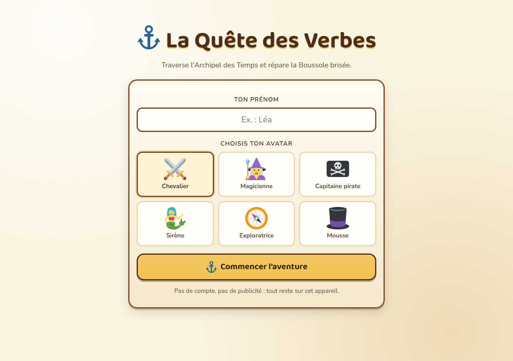
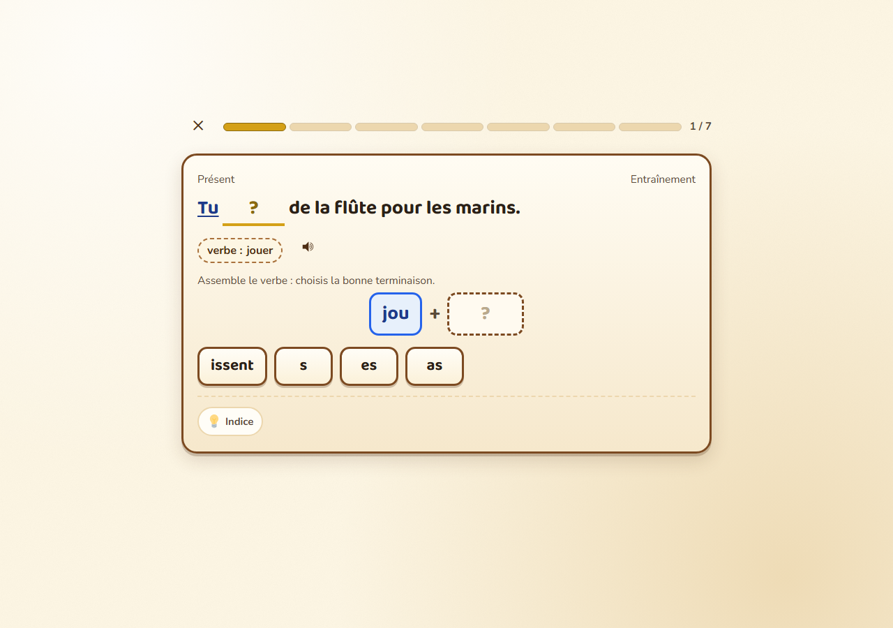
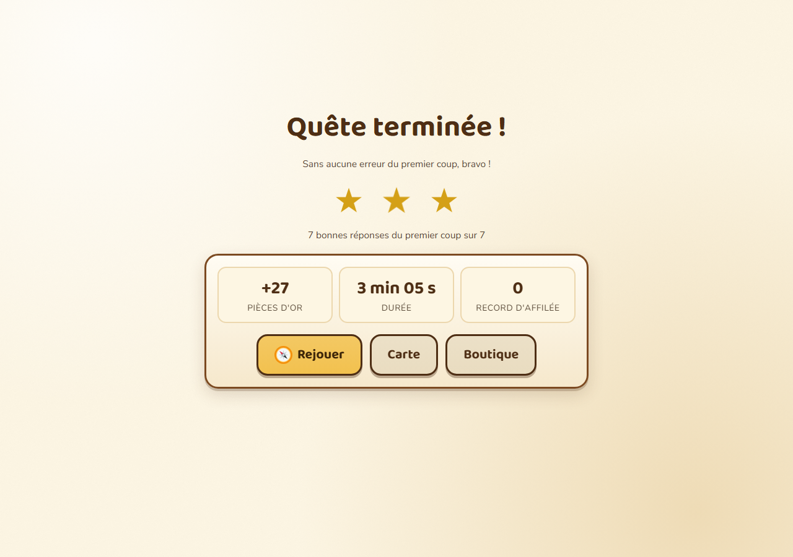

# La Quête des Verbes

**Un jeu de conjugaison pour le CE2 (8 ans), à jouer dans le navigateur, sans compte, sans publicité et sans connexion.**

Traverse l'Archipel des Temps, bats les quatre Gardiens et répare la Boussole brisée.
Chaque île cache une aiguille : présent, imparfait, futur, passé composé.



## Jouer

- **En ligne** : <https://brunothesatellite.github.io/aventure-conjugaison/>
- **Hors ligne** : téléchargez le dépôt et double-cliquez sur `index.html` (voir ci-dessous).

## Lancer le jeu

1. Téléchargez le dépôt (bouton **Code → Download ZIP**) ou clonez-le :
   `git clone https://github.com/brunothesatellite/aventure-conjugaison.git`
2. Ouvrez le dossier et **double-cliquez sur `index.html`**.

C'est tout. Aucune installation, aucun serveur, aucune connexion : le jeu fonctionne en
`file://` dans Edge, Chrome ou Firefox. La progression est enregistrée dans le navigateur
(`localStorage`), sur cet appareil uniquement.

> Sur Windows, si le double-clic ouvre un éditeur de texte, faites un clic droit sur
> `index.html` → **Ouvrir avec** → votre navigateur.

## Ce qu'on y apprend

| Île | Temps | Verbes travaillés |
|---|---|---|
| L'Île du Présent | Présent de l'indicatif | être, avoir, verbes en -er, -ir, aller, faire, dire, venir |
| La Vallée des Souvenirs | Imparfait | verbes réguliers et irréguliers, pièges je/tu |
| L'Océan des Prophéties | Futur simple | radicaux irréguliers, terminaisons en -rai/-ras/-ront |
| La Crique des Exploits | Passé composé | auxiliaires être et avoir, accords, participes passés |

**20 verbes**, **170 phrases** contextualisées (pirates, trésors, voyage), **16 niveaux**
et **4 Gardiens**. Le programme suit les repères du CE2 : reconnaissance, puis production,
avec un travail explicite des régularités et des exceptions.

## Comment se passe une quête

Une quête = **7 questions** : deux révisions espacées, l'entraînement du jour, puis un défi
qui mélange les temps déjà vus. Deux types d'exercices alternent :

- **choix multiple** entre 3 formes : une autre personne du verbe, un autre temps déjà vu,
  ou une faute typique (jamais de forme inventée) ;
- **assemblage** : on choisit la bonne terminaison à coller au radical.



Les principes anti-frustration :

- **L'erreur ne coûte rien.** Deux essais, puis la bonne réponse est révélée et l'enfant la
  recopie activement. Une micro-leçon explique l'erreur (accord, terminaison, auxiliaire…).
- **Les étoiles ne se perdent jamais.** On peut rejouer un niveau pour faire mieux.
- **La série est un record personnel**, pas une flamme qui s'éteint.
- **Pas de chronomètre, pas de classement, pas de vies.**

L'or gagné s'échange contre des familiers qui aident pendant les quêtes (un coup de pouce
sur la terminaison, éliminer un mauvais choix, rappeler la règle), **20 déguisements à
collectionner** (du bandeau de pirate à la couronne de laurier à 2 000 pièces) et des
récompenses réelles négociées avec les parents. Chaque récompense achetée laisse une trace
datée dans le carnet de bord, avec son parchemin réimprimable.



## Espace parent

Sur la carte, **maintenez le cadenas « Parents » appuyé 1,2 seconde** (ou tabulez jusqu'au
bouton et appuyez sur Entrée). Au premier accès, créez un **code à 4 chiffres**.

Vous y trouverez :

- les statistiques de progression et les types d'erreurs les plus fréquents ;
- trois **récompenses réelles** à personnaliser (texte, prix en or et **icône** choisie
  parmi une liste : temps d'écran, film, sortie, cadeau, balade…) ;
- un bouton **Verrouiller l'espace** : le code sera redemandé au prochain appui long,
  sans attendre de fermer le jeu ;
- l'export et l'import de la sauvegarde (fichier JSON) ;
- le changement de code et l'effacement complet.

Le code PIN évite les clics par erreur ; il ne protège pas contre un enfant déterminé.

Les réglages (taille du texte, animations, voix) sont accessibles depuis la carte.
Tout est local : aucune donnée n'est envoyée nulle part.

## Ajouter du contenu

L'architecture est volontairement simple : **un fichier = un objet**, puis une balise
`<script>` dans `index.html`. Pas de build, pas de module ES (indispensable pour que
`file://` fonctionne).

### Un verbe

`content/verbs/danser.js` :

```js
(function (Q) {
  Q.registerVerb({
    id: "danser",
    infinitif: "danser",
    groupe: 1,
    auxiliaire: "avoir",
    participe: "dansé",
    formes: {
      present:       { je: "danse", tu: "danses", il: "danse", elle: "danse", nous: "dansons", vous: "dansez", ils: "dansent", elles: "dansent" },
      imparfait:     { je: "dansais", tu: "dansais", il: "dansait", elle: "dansait", nous: "dansions", vous: "dansiez", ils: "dansaient", elles: "dansaient" },
      futur:         { je: "danserai", tu: "danseras", il: "dansera", elle: "dansera", nous: "danserons", vous: "danserez", ils: "danseront", elles: "danseront" },
      passe_compose: { je: "ai dansé", tu: "as dansé", il: "a dansé", elle: "a dansé", nous: "avons dansé", vous: "avez dansé", ils: "ont dansé", elles: "ont dansé" }
    },
    pieges: ["je dansais / tu dansais (identiques)"],
    note: "Verbe régulier du 1er groupe : radical dans- + terminaisons."
  });
})(window.Quete);
```

Puis dans `index.html`, à la suite des autres verbes :

```html
<script src="content/verbs/danser.js"></script>
```

### Des phrases

Chaque phrase contient **son pronom** (la question n'est jamais ambiguë) et un jeton
`{trou}` à l'endroit de la forme à conjuguer. Le champ `personne` sert à la logique.

```js
Q.registerPhrases("present", [
  { id: "danser-present-nous-01", verbe: "danser", temps: "present",
    personne: "nous", difficulte: 1, texte: "Nous {trou} sur le pont du navire." }
]);
```

Prévoyez **au moins 2 phrases par verbe et par niveau** (le linter le vérifie).

### Une aventure (île)

`content/adventures/…js` décrit le récit, le décor, les quatre niveaux et le Gardien.
L'ordre des îles et les seuils de déblocage sont dans `content/curriculum.js`.

## Vérifier le contenu

```bash
node tools/lint-content.js
```

Le linter charge tout le contenu dans un contexte isolé et vérifie : structure des verbes,
cohérence auxiliaire/participe, présence du pronom, unicité des réponses, distracteurs,
découpage radical/terminaison. Il sort en erreur (code 1) si un problème est détecté —
utilisable dans un hook Git.

## Outils de maintenance

| Commande | Rôle |
|---|---|
| `node tools/lint-content.js` | Valide verbes, phrases, aventures et exercices |
| `node tools/audit-distracteurs.js` | Relit les mauvais choix des 170 questions (familles A/B/C) |
| `node tools/preparer-icones.js` | Retire le fond plein des SVG game-icons (idempotent) |
| `node tools/generer-icones-inline.js` | Régénère les pictos intégrés (`assets/icons-inline.js`) |
| `node tools/generer-manifest.js` | Régénère `assets/manifest.json` et `CREDITS.md` |
| `node tools/test-navigateur.mjs` | Test de bout en bout dans Edge (voir ci-dessous) |

### Test navigateur

```bash
node tools/test-navigateur.mjs
```

Le script pilote Microsoft Edge en mode headless via le protocole DevTools : création de
profil, quête complète, étoiles, or, persistance après rechargement, correction active,
espace parent, aides des familiers. Il vérifie aussi qu'aucune erreur console n'apparaît.
Définissez `NAVIGATEUR` si Edge n'est pas au chemin par défaut :

```bash
set NAVIGATEUR=C:\Program Files\Google\Chrome\Application\chrome.exe
node tools/test-navigateur.mjs
```

## Arborescence

```
index.html              point d'entrée, ordre de chargement des scripts
main.js                 démarrage, réglages, navigation globale
content/                tout le contenu pédagogique
  registry.js           enregistrement + validation
  curriculum.js         ordre des îles, prérequis, seuils
  verbs/                un fichier par verbe
  phrases/              une banque par temps
  adventures/           un fichier par île
engine/                 moteur de jeu (état, sauvegarde, exercices, SRS, audio)
ui/                     briques d'interface et écrans
assets/                 CSS, polices, pictos, émojis, décors
  icons-inline.js       pictos intégrés en SVG (généré, compatibles file://)
  manifest.json         inventaire des assets (licence, auteur, source)
tools/                  linter et scripts de maintenance
docs/captures/          captures d'écran du README
```

## Choix techniques

- **Aucun serveur, aucun build.** Des scripts classiques et un espace de noms
  `window.Quete` : le jeu s'ouvre par double-clic, y compris hors ligne.
- **Aucun CDN.** Polices, pictos et émojis sont auto-hébergés.
- **Pictos en SVG inline.** Un SVG chargé comme masque CSS est bloqué par les navigateurs
  en `file://` : les icônes étaient invisibles au double-clic. Elles sont donc intégrées au
  jeu (`assets/icons-inline.js`) et gardent la couleur du texte (`currentColor`).
- **Aucun pistage.** Pas de compte, pas d'analytics, pas de cookies.
- **Sons générés** avec l'API Web Audio et la synthèse vocale du navigateur : aucun
  fichier audio à télécharger.
- **Sauvegarde versionnée** (`quete-verbes:v1`) avec fusion douce en cas de migration.
- **Accessibilité** : navigation clavier, libellés ARIA, contraste élevé, taille de texte
  réglable, respect de `prefers-reduced-motion`.

## Licences

- **Code** : MIT (voir `LICENSE`).
- **Textes, contenus pédagogiques et illustrations originales** : CC BY-SA 4.0
  (voir `LICENSE-CONTENU.md`).
- **Ressources tierces** : pictogrammes game-icons.net (CC BY 3.0), émojis Twemoji
  (CC BY 4.0), polices Baloo 2 et Nunito (SIL OFL 1.1). Chaque fichier est déclaré avec
  son auteur et sa source dans [`CREDITS.md`](CREDITS.md).
